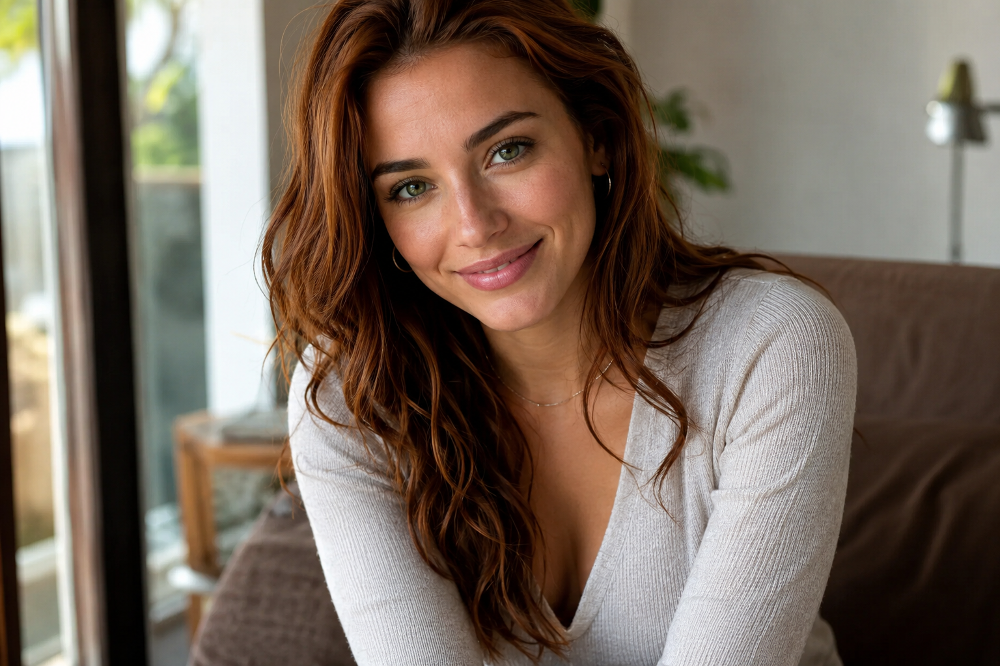
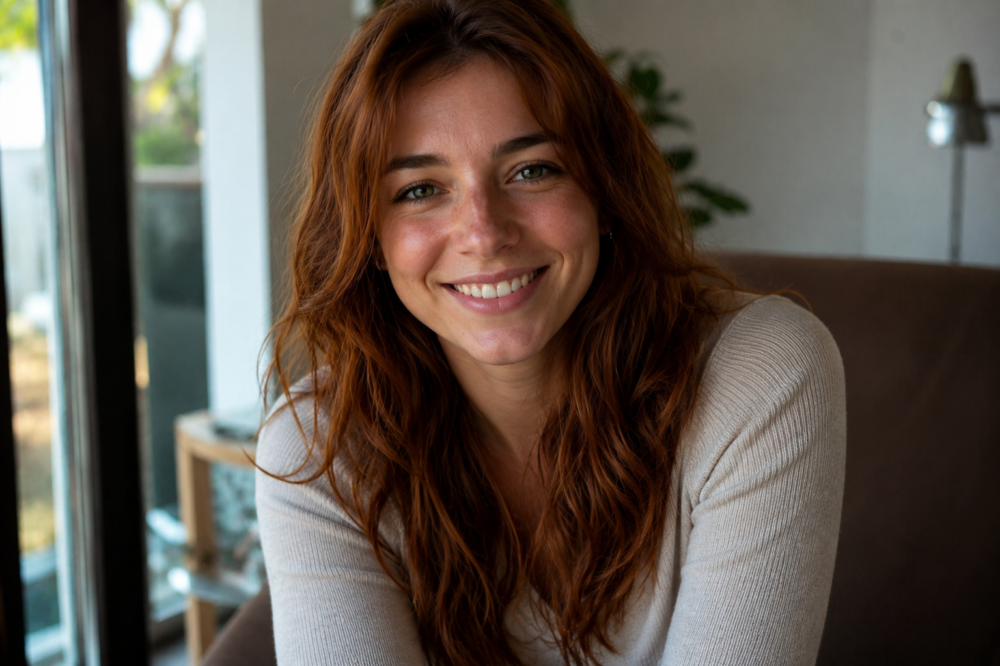
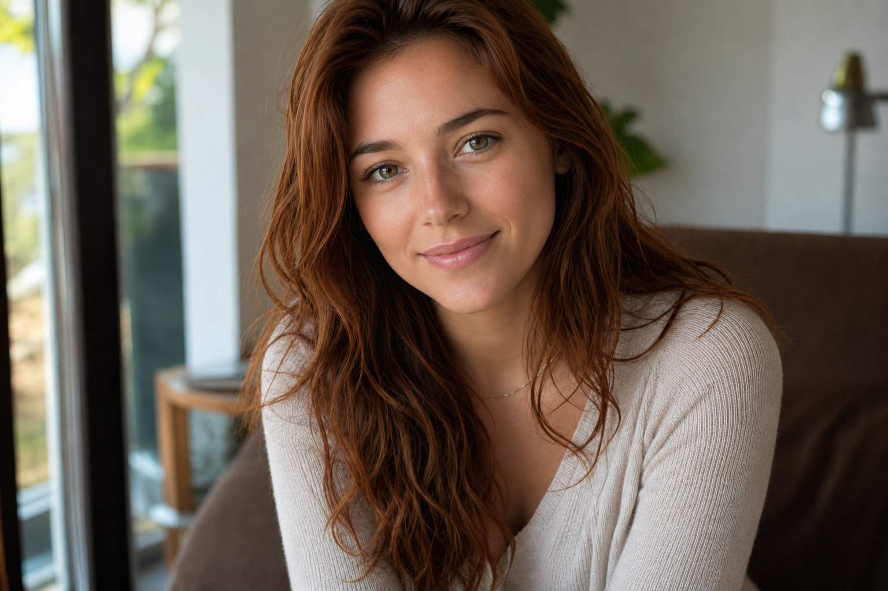

# RumiAI Avatar

> Archivio della sequenza attiva della conversazione condivisa.
> Sorgente: https://chatgpt.com/share/6ad13a5b-e9f0-83eb-8519-9e2d8c8097f3
> Messaggi testuali visibili: 3.
> Immagini, file e attività intermedie sono posizionati secondo i nodi originali.

---

## UTENTE

crea un'immagine: donna di circa 24 anni;
capelli rame scuro, lunghi e leggermente mossi;
occhi verde smeraldo, intensi ma non innaturali;
pelle chiara, ma senza lentiggini;
corporatura armoniosa e atletica, senza estremi;
sorriso caldo e autentico;
abbigliamento casual contemporaneo, con colori neutri;
fotografie in luce naturale, evitando estetiche futuristiche;
uno sguardo che comunica attenzione e presenza, come se stesse davvero ascoltando.

## ASSISTENTE — immagine generata

## UTENTE

bella, ma Non una modella.

Non un'attrice.

Una persona che potresti incontrare davvero. Piccole imperfezioni. Sorriso naturale.

## ASSISTENTE — immagine generata

## UTENTE

annulla queste modifiche e riparti dall'immagine precedente. fai queste modifiche: pelle senza macchie, sopracciglia più naturali, meno fossette, cambia il naso, senza orecchini, mento più morbido

## ASSISTENTE — immagine generata

